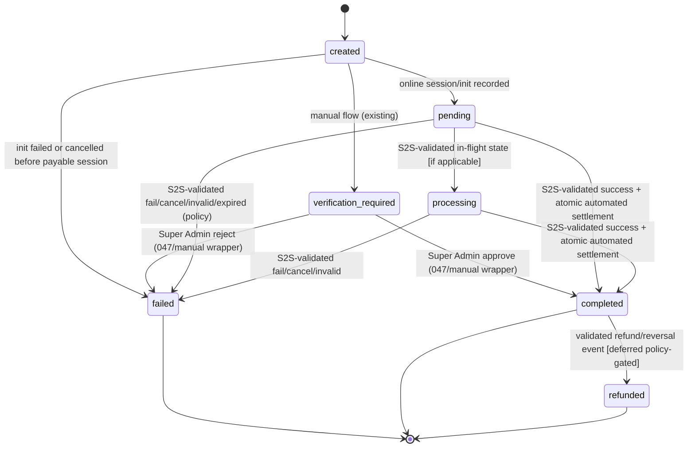

# Payment Settlement Architecture Decision Record (ADR)

**Document:** Phase 2.3 — Final Payment Settlement Architecture Decision Record  
**Status:** Proposed (READ-ONLY). **Not implemented. No implementation authorized. Gateway integration is not ready.**  
**Primary reference:** `docs/architecture/PAYMENT_SETTLEMENT_ARCHITECTURE.md` (treated as the primary proposal; this ADR resolves its outstanding decisions).  
**Date:** 2026-11-12  
**Scope:** Subscription payments (upgrade/renewal focus per verified flows; initial/downgrade noted where relevant), provider-neutral design with SSLCOMMERZ as intended first gateway.

## Legend
| Label | Meaning |
|---|---|
| **[Existing]** | Verified in current codebase/migrations (037–048 applied). |
| **[Proposed]** | Architecture decision/recommended design; not present today. |
| **[Requires SSLCOMMERZ docs]** | Must be confirmed from official SSLCOMMERZ documentation/merchant contract; not assumed. |
| **[REQUIRES HUMAN APPROVAL]** | Business/policy/product decision that must be explicitly approved before implementation. |

**Hard constraints:** migrations **037–048 are applied and immutable** (no edits). Any DB evolution via **new migrations only**. Manual Super Admin verification must remain functional. No invented gateway fields/behavior.

---

## 1. Context

Storefy requires a production-grade, secure settlement path for online gateway payments while preserving the existing trusted manual verification flow. The primary proposal defines the target flow (initiation → gateway session → redirect → IPN/callback → server-to-server validation → atomic automated settlement → subscription update → audit) but leaves critical decisions unresolved: how to share settlement logic without weakening authorization, how to represent system settlements in audit, exact online lifecycle semantics, session retry/expiry, manual override policy, refund/reversal scope, reconciliation ownership, and initial-scope boundaries.

This ADR resolves those decisions to produce an implementation-ready blueprint. **Gateway-specific contracts remain external prerequisites**; this document does not claim readiness.

---

## 2. Existing verified state

- **Creation (trusted, server-side):** `POST /api/subscriptions/payments/upgrade` (`app/api/subscriptions/payments/upgrade/route.ts`), `POST /api/subscriptions/payments/renewal` (`app/api/subscriptions/payments/renewal/route.ts`) → `lib/subscriptions/payments.ts`. `authorizeTenant()` derives tenant from server auth (tenant admin or super admin); client cannot supply tenant/subscription/amount. Constants: `provider='manual'`, `currency='BDT'`, `status='verification_required'`.
- **Calculation:** `lib/subscriptions/payment-calculation.ts` — server proration (`prorateUpgradeAmount`) and deterministic renewal period `start=max(current_period_end,now)`, `end=start+1mo` (`computeRenewalPeriod`).
- **Upgrade persistence (atomic):** `public.create_subscription_upgrade_payment` (048, `SECURITY DEFINER`, `search_path=pg_catalog,public`, **execute revoked from PUBLIC/anon/authenticated, granted to `service_role` only**). Locks subscription, validates state/plan/price/schedule, sets `scheduled_plan_id/scheduled_plan_change_at`, inserts `verification_required` payment with trusted `target_plan_id`/`expected_amount` (manual provider). Idempotency in service: `sub_upgrade:{subscriptionId}:{targetPlanId}` (+ retry suffix on failed) with RPC conflict recovery.
- **Renewal persistence:** direct insert with deterministic idempotency `sub_renewal:{subscriptionId}:{renewalPeriodEndISO}` and uniqueness/`23505` recovery (046/038 constraints); trusted `renewal_period_start/end`.
- **Manual settlement (authoritative):** `POST /api/platform/payments/[id]/verify` (`app/api/platform/payments/[id]/verify/route.ts`, super-admin guarded) calls `public.approve_or_reject_payment` (047). 047: `SECURITY DEFINER`, `search_path` pinned, **execute revoked from PUBLIC, granted to `authenticated, service_role`**; enforces `is_super_admin()` (via `auth.uid()`), decision/status/purpose validation, `FOR UPDATE` locks (payment, subscription), tenant consistency fail-closed, trusted-field checks (renewal period continuity/bounds & eligibility; upgrade target/expected/scheduled/active/currency/amount match), atomic transition `verification_required → completed|failed`, subscription side-effects (initial/renewal activate with payment-bound trusted periods; upgrade applies `plan_id` immediately, clears schedule, preserves billing dates/usage; downgrade confirms intent; matching-upgrade rejection clears stale schedule), immutable audit insert, idempotent on terminal/repeat/concurrent cases.
- **Audit:** `payment_verification_audit` (042) — `admin_user_id uuid NOT NULL` FK `auth.users`, `decision in ('approved','rejected')`, previous/new status, reason, `created_at`; RLS super-admin SELECT; **no authenticated INSERT**, append-only, `service_role` full grant.
- **Types/UI:** `types/index.ts` defines `Payment`, `PaymentVerificationAudit`, statuses/providers/purposes. `lib/payments/verification.ts` derives view/audit timeline (sources `system|gateway|admin`, treats audit rows as admin). `app/platform/payments/[id]/page-client.tsx` shows manual approve/reject only when `status === 'verification_required'` and not mock; mock preview is dev-only (`lib/payments/verification-mock.ts`). Existing UI/types assume admin-attributed audit rows and manual-only actionable state.
- **Gaps (existing):** no gateway session/init, no callback/IPN routes, no server-to-server validation, no automated settlement path, no provider abstraction; 048/service hardcode manual/`verification_required`.

---

## 3. Architectural decisions

### Decision 1 — Settlement core structure

- **Recommended choice:** **A. Shared internal settlement core** (new migration) invoked by two thin, separately-privileged wrappers: (1) manual Super Admin wrapper preserving 047’s external contract/authorization; (2) automated gateway wrapper restricted to `service_role`.
- **Reasoning:** 047 encodes a complex, security-critical invariant matrix (locks, tenant fail-closed, trusted period/target/expected/amount/currency checks, idempotency, exact subscription effects, audit). A single core minimizes logic drift and eases parity verification; thin wrappers isolate authorization/actor semantics per entrypoint. PostgreSQL supports this safely when the core is not externally executable.
- **Alternatives rejected:** **B. Duplicated RPCs** — rejected as primary: high drift risk across renewal/upgrade edge cases and future fixes; doubles audit/maintenance surface; parity is hard to prove over time. (Acceptable only as a temporary fallback if refactor proves infeasible, but not recommended.)
- **Security implications & guardrails (non-weakening):**
  - Core implemented as `LANGUAGE plpgsql` internal function (preferred: not `SECURITY DEFINER` in its own right, or `SECURITY DEFINER` with locked-down owner) **never exposed**: `REVOKE ALL ON FUNCTION ...core... FROM PUBLIC, anon, authenticated, service_role`; grant execute only to the owning role if required by definer context, or keep callable solely within same-migration definer functions.
  - **Manual wrapper:** retains `is_super_admin()` check (or equivalent current guard), `SECURITY DEFINER`, `search_path=pg_catalog,public`, execute `authenticated, service_role` (same posture as 047) — **no weakening**. External signature/behavior preserved for `/api/platform/payments/[id]/verify`.
  - **Automated wrapper:** `SECURITY DEFINER`, pinned `search_path`, **`REVOKE ALL FROM PUBLIC, anon, authenticated`; `GRANT EXECUTE ... TO service_role` only**. Callable exclusively from server-side service context after successful S2S validation; never from client/JWT user contexts. It must not accept or rely on `auth.uid()` as a Super Admin.
  - Both wrappers pass a validated actor/outcome context into the core; core performs identical invariant checks and conditional transitions under `FOR UPDATE`.
  - Function ownership pinned to a controlled role in migration; `search_path` fixed to prevent object shadowing.
- **Consequences/trade-offs:** Requires careful new-migration refactor and regression coverage for manual flow (risk mitigated by parity tests). Delivers long-term correctness and a single source of truth for settlement invariants.

### Decision 2 — System settlement audit identity

- **Recommended choice:** **Smallest safe schema evolution (new migration)** to represent system/gateway actors explicitly without fabricating a Super Admin: make `admin_user_id` **nullable**, add `actor_type` (constrained, e.g. `super_admin|system_gateway`), and add `actor_source`/`event_source` (text, e.g. `manual_verification|gateway_sslcmerz_ipn`) plus optional nullable `actor_label`/`external_reference` if needed for correlation; keep `payment_id`, `decision`, previous/new status, `reason`, `created_at` immutable. Backfill existing rows as `actor_type='super_admin'` with existing `admin_user_id`.
- **Reasoning:** Current schema (`admin_user_id NOT NULL` FK to `auth.users`, decision constrained to approved/rejected) **cannot accurately represent** automated settlements: it would force a fake user or violate constraints. Automated actions must be distinguishable and non-repudiable without impersonation.
- **Alternatives rejected:**
  - **Sentinel/service “user” in `auth.users`:** rejected — falsely models a human identity, complicates RLS/FK semantics, and risks attribution confusion.
  - **Metadata-only (no columns) while keeping NOT NULL admin_user_id:** rejected — impossible without fake identity; loses queryability/integrity.
  - **Separate audit table for automated events:** rejected as primary — fragments immutable history and complicates unified timelines; may be a later additive view, not the source of truth.
- **Consequences/trade-offs:** Requires coordinated updates to `types/index.ts`, `lib/payments/verification.ts` timeline mapping, and Super Admin UI to render system vs admin actors; RLS remains super-admin read (and must continue to block authenticated writes). **Manual decisions must always populate `admin_user_id` and `actor_type='super_admin'`. Automated settlements must set `admin_user_id NULL` and `actor_type='system_gateway'` with source populated.**
- **Dependencies/notes:** Preserves immutability (no UPDATE/DELETE policies). Exact column naming finalized at migration design; keep additive and backward-readable.

### Decision 3 — Online payment lifecycle

- **Recommended choice:** Distinguish **gateway/processing states** from **Storefy settlement states** while reusing existing `payments.status` enum values (no new enum required initially) and preserving manual flow:
  - **Manual (unchanged):** `verification_required` → `completed | failed` via Super Admin 047/manual wrapper only.
  - **Gateway/online (proposed):** `pending` (internal payment created, session/init in progress or awaiting customer/gateway) → `processing` (gateway indicates in-flight/authorized-not-final, **only if confirmed by S2S-validated state**) → `completed | failed` **only** via trusted automated settlement after S2S validation; `refunded` reserved for post-settlement reversal events (policy-gated).
  - `pending`/`processing` are **non-settled, non-entitling**: no subscription activation/plan change. `completed`/`failed` are terminal settlement outcomes (subject to later `refunded` per policy).
  - Browser redirects never transition to `completed`.
- **Reasoning:** Aligns with existing allowed statuses (038) and current UI derivations while cleanly separating “awaiting/processing” from “settled”. Keeps `verification_required` semantically reserved for manual review, avoiding ambiguity in existing admin actions.
- **Alternatives rejected:**
  - **Reusing `verification_required` for online-in-flight:** rejected — collides with manual-verify UI/API gating and conflates “needs human decision” with “awaiting gateway validation”.
  - **Introducing new enum values immediately:** deferred — possible later if product needs finer-grained states; current enum is sufficient when paired with metadata/source.
- **Consequences/trade-offs:** Requires clear mapping from gateway outcomes to these states; **gateway-specific status codes/meanings require official documentation** `[Requires SSLCOMMERZ docs]`. Tenant/admin UI must render online vs manual states distinctly.
- **[REQUIRES HUMAN APPROVAL]** Final product mapping of “pending vs processing” exposure and whether a distinct “cancelled/expired” user-facing label is represented as `failed` with reason vs another representation.

### Decision 4 — Gateway session retry and expiry

- **Recommended choice:** **One internal payment represents one logical payment attempt and one authoritative settlement outcome**; it may have **multiple gateway session/init attempts over time** (recorded in `metadata`/session history) until the payment reaches a **terminal settlement state** (`completed`, `failed`, `refunded`) or is explicitly superseded by policy. A new gateway session **does not** create a new internal payment by default; it refreshes/records session refs on the same payment when the attempt is still non-terminal and retry is permitted.
- **Rules:**
  - **Duplicate submissions:** prevented by existing deterministic idempotency keys and uniqueness (`sub_upgrade:{subscriptionId}:{targetPlanId}` + retry suffix only after a definitively failed prior attempt per existing logic; `sub_renewal:{subscriptionId}:{renewalPeriodEndISO}`) and by reusing an existing non-terminal payable record/session where valid.
  - **Expiry:** if a session expires without a definitive validated outcome, payment remains non-terminal (`pending/processing`) and becomes eligible for re-init (new session ref) or expiry-to-failed per policy; **must not** be auto-settled.
  - **New internal payment:** created only when business rules require a new attempt (e.g. prior `failed` with retry keying as today, or materially changed trusted terms such as renewal period/amount) — never to bypass idempotency.
  - **Late callbacks/IPN:** always correlated to stored refs, S2S-validated, and applied idempotently; if the internal payment is already terminal for the same validated transaction, treat as no-op. A late success for a payment already `failed` (or vice versa) is resolved by **validated authoritative state + conflict rules**: never double-apply effects; escalate mismatches to reconciliation.
- **Reasoning:** Preserves accounting/audit continuity, prevents duplicate entitlements, and aligns with deterministic idempotency and 047-style idempotent settlement.
- **Alternatives rejected:**
  - **New internal payment per session attempt:** rejected — explodes records, complicates idempotency/UX, and risks duplicate settlement paths.
  - **One session strictly forever:** rejected — incompatible with real gateway expiry/retry behavior.
- **Consequences/trade-offs:** Requires careful metadata schema/conventions for session history and clear “attempt expired” UX. **[Requires SSLCOMMERZ docs]** session lifetime, re-init rules, tran_id reuse constraints. **[REQUIRES HUMAN APPROVAL]** retry window/count limits, when to mark expired attempts `failed`, and customer-facing retry policy.

### Decision 5 — Manual override policy (gateway-initiated payments)

- **Recommended choice:** **Restrict by default.** For gateway-initiated/online payments, Super Admin **cannot** directly force `completed` (no subscription side-effects) outside the validated settlement path. Permitted manual actions are limited to **controlled exception handling**: (a) mark/record an investigated failure or reconciliation outcome as `failed` (non-entitling) when authoritative evidence shows non-payment/invalidity and no conflicting validated success exists, and/or (b) annotate/request revalidation; any action that would grant entitlement **must** flow through a trusted, validated settlement (automated S2S path or a separately authorized, evidence-backed reconciliation settlement procedure) that enforces full invariants.
- **Allowed conditions (if/when a manual exception action is used):** payment is gateway-initiated, non-terminal or in a defined exception state per policy, and there is no validated successful settlement recorded; evidence attached (gateway validation evidence/reference, investigation notes). **[REQUIRES HUMAN APPROVAL]** exact eligible states and exception catalog.
- **Required verification evidence & reason:** mandatory reason; linkage to server-to-server validation result or documented investigation artifact; stored in audit/metadata with actor identity. Never rely on screenshots/redirects as proof of success.
- **Audit requirements:** immutable audit entry with `actor_type='super_admin'`, explicit action/outcome, reason, and evidence refs; distinguishable from automated `system_gateway`.
- **Interaction with automated settlement:** **Automated settlement must not overwrite a finalized manual decision** inconsistently. Define precedence: a recorded, validated successful settlement is authoritative for entitlement; a manual failure/closure may block further auto-complete unless explicitly reopened by policy. All transitions must be conditional/idempotent under locks.
- **Conflict/concurrency handling:** resolve via `FOR UPDATE`, terminal-state checks, and “first valid terminal outcome wins” for identical validated transactions; conflicting evidence triggers reconciliation state/alert, not blind overwrite. **[REQUIRES HUMAN APPROVAL]** precedence matrix and reopen policy.
- **Reasoning:** Prevents privilege misuse and bypass of S2S validation while giving ops a safe path for non-entitling exception closure.
- **Alternatives rejected:**
  - **Unrestricted Super Admin approve/reject for all gateway payments:** rejected — bypasses gateway authenticity/amount validation and undermines automated trust model.
  - **No manual capability at all:** rejected — leaves ops unable to close/reconcile false-pending or invalid cases.
- **Consequences/trade-offs:** Some edge cases require reconciliation tooling rather than one-click approval; improves safety and auditability.

### Decision 6 — Refund, reversal, and chargeback scope

- **Recommended choice (phased):**
  - **Initial gateway integration (in-scope):** record and settle **forward payments only** (success/failure/cancel/pending) with S2S validation and reconciliation for settlement correctness. Expose refund/reversal **visibility** only if gateway provides authoritative signals and they can be recorded safely as payment-state/audit events **without** automatic subscription mutation.
  - **Deferred (post-initial, policy-gated):** `refund requested/processing/completed`, `payment reversal`, and `chargeback/dispute` **business effects** (including any subscription downgrade/cancel/entitlement adjustment), financial reconciliation, and customer communications workflows.
- **Distinctions (must remain explicit):** *refund requested* (intent/initiation) ≠ *refund processing* (in-flight) ≠ *refund completed* (funds returned per authoritative confirmation) ≠ *payment reversal* (acquirer/gateway reversal) ≠ *chargeback/dispute* (contested, potentially multi-stage). Each is a separate event/state with different evidence and timing.
- **Reasoning:** Subscription/entitlement impact of refunds and disputes is business-critical and gateway-specific; coupling it to first integration raises correctness and compliance risk.
- **Alternatives rejected:** **Automatic subscription reversal on refund signal in v1:** rejected — unsafe without explicit policy, proration/period rules, and confirmed gateway semantics.
- **Consequences/trade-offs:** Operators may need manual/offline handling for refunds initially. **[Requires SSLCOMMERZ docs]** refund/reversal/chargeback notification support and fields. **[REQUIRES HUMAN APPROVAL]** entitlement/proration policy, timing (immediate vs period-end), and dispute-handling ownership.

### Decision 7 — Reconciliation and recovery

- **Recommended choice:** Establish a defined reconciliation function with automated detection + ops runbooks.
  - **Ownership:** **[REQUIRES HUMAN APPROVAL]** (recommend: primary = platform/operations with engineering escalation; finance notified for monetary discrepancies).
  - **Frequency:** **[REQUIRES HUMAN APPROVAL]** (recommend: automated sweep at least every 15 minutes for aged non-terminal gateway payments plus on-demand; daily summary report).
  - **Alert thresholds (recommend, to be ratified):** immediate alert for any `validated-success but not settled` or `amount/currency/merchant mismatch`; alert if non-terminal gateway payment exceeds expected confirmation window (e.g. >30–60 min, tuned) or validation failures spike; page/escalate on repeated settlement exceptions. **[REQUIRES HUMAN APPROVAL]**
  - **Payment received but not settled:** detect by revalidating with gateway (S2S), enqueue retry of idempotent automated settlement; if invariant failure, lock for manual investigation (no blind credit). Track until converged.
  - **Unresolved/indeterminate gateway status:** keep non-terminal, continue bounded retry/backoff and scheduled reconciliation; do not guess or settle; escalate after SLA breach.
  - **Post-outage recovery:** assume at-least-once IPN/redelivery; on restart run reconciliation sweep, revalidate candidates, rely on idempotent/locked settlement to converge exactly-once effects.
- **Reasoning:** Gateway and app availability are decoupled; explicit ownership and thresholds prevent silent revenue/entitlement drift.
- **Alternatives rejected:** **Best-effort/manual-only reconciliation:** rejected — insufficient for correctness at scale.
- **Consequences/trade-offs:** Requires ops capacity, dashboards, and alerting plumbing; reduces financial and access-control risk.

### Decision 8 — Initial gateway integration scope (subscription types)

- **Recommended choice:** **Initial scope = `subscription_upgrade` and `subscription_renewal` only.** Exclude `subscription_initial` (and exclude downgrade settlement beyond existing intent/cron behavior) from first gateway rollout.
- **Reasoning (grounded in existing implementation):** Verified, server-trusted, atomic/idempotent creation and settlement invariants exist for upgrades (048 RPC + scheduling + 047 immediate application on approval with trusted `target_plan_id/expected_amount`) and renewals (deterministic payment-bound `renewal_period_*`, continuity/catch-up rules, uniqueness, 047 activation/extension). There are **no verified tenant-facing gateway-ready initiation flows for `subscription_initial`** in inspected subscription payment APIs/services; 047’s initial path activates from `now()` with different preconditions and would require a separately designed, trusted initiation/quoting/period contract to avoid ambiguity.
- **Alternatives rejected:** **Include `subscription_initial` in v1:** rejected for first phase — expands surface into unverified acquisition/provisioning flows and risks inconsistent period/amount trust without a defined initial-payment creation path.
- **Consequences/trade-offs:** New customers (or tenants without a renewable/upgradeable paid state) cannot complete initial subscription purchase via gateway in v1 and must rely on existing/manual/onboarding processes as applicable; upgrades/renewals for eligible existing subscriptions gain gateway support first. **[REQUIRES HUMAN APPROVAL]** confirm business acceptability and onboarding fallback.

---

## 4. Alternatives considered (cross-cutting summary)

| Topic | Considered | Outcome |
|---|---|---|
| Settlement reuse | Shared core vs duplicated RPCs | Shared core recommended; duplication rejected (drift) |
| Audit actor | Nullable/system columns vs sentinel user vs metadata-only vs separate table | Nullable + actor fields recommended |
| Online states | Reuse `verification_required` vs map to `pending/processing/completed/failed` | Map to pending/processing/completed/failed; keep manual `verification_required` |
| Session model | Per-session internal payments vs session history per attempt | Session history per logical attempt |
| Manual override | Unrestricted vs none vs restricted exception-only | Restricted, evidence-backed, non-entitling by default |
| Refunds in v1 | Full automation vs forward-only settlement | Forward-only settlement; refunds/reversals/chargebacks deferred |
| Reconciliation | Manual-only vs defined automated+ops | Defined automated+ops with approved SLAs |
| Scope | Include initial vs upgrade+renewal | Upgrade+renewal only in v1 |

---

## 5. Security implications

- **Authorization boundaries:** manual wrapper preserves `is_super_admin()`; automated wrapper is `service_role`-only; shared core not directly executable. No client-initiated settlement.
- **Integrity of settlement:** S2S validation is the sole proof for gateway outcomes; redirects are UX-only. Fail-closed on correlation/amount/currency/merchant/status uncertainty.
- **Atomicity & concurrency:** `FOR UPDATE` locking, conditional/idempotent transitions, and uniqueness constraints prevent double-settlement and duplicate subscription effects.
- **Tenant isolation:** strict tenant/payment/subscription consistency checks (existing 047 invariants) remain mandatory.
- **Auditability:** immutable, attributable records (no fabricated Super Admin); system actions clearly labeled.
- **Secrets & data handling:** gateway credentials server-only; redact/minimize sensitive gateway fields in logs/metadata/UI. Rate limiting and strict parsing on unauthenticated callback endpoints.
- **Residual risk:** misconfiguration or deviation from shared core/parity tests can reintroduce drift; mitigated by mandatory parity and security test matrix (blueprint §10).

---

## 6. Database and API implementation blueprint

### 6.1 Final payment lifecycle state machine

**Notes:** gateway-to-state mapping and “cancelled/expired” representation `[Requires SSLCOMMERZ docs]` and `[REQUIRES HUMAN APPROVAL]` (§3.3). `refunded` transition mechanics deferred (§3.6).

### 6.2 Final settlement architecture

- **Shared core (internal):** validates/assumes locked payment+subscription context, enforces 047-equivalent invariants, applies status transition and subscription side-effects, writes immutable audit with provided actor context. Not directly executable by untrusted roles.
- **Manual wrapper:** Super Admin authz + existing RPC contract → core (actor `super_admin`, `admin_user_id=auth.uid()`).
- **Automated wrapper:** `service_role`-only, post-S2S-validated inputs → core (actor `system_gateway`, `admin_user_id=NULL`, source refs). Called only by server settlement orchestrator after validation/correlation checks.
- **Orchestrator (app, server-only):** IPN handler → load/correlate → S2S validate → normalize → invoke automated wrapper → persist observability; idempotent on repeats/out-of-order per §3.4/§7.

### 6.3 Database migration plan (new migrations only; no SQL authored here)

1. **Audit evolution:** nullable `admin_user_id`, add `actor_type`/`actor_source` (and optional refs), backfill existing rows, adjust constraints/indexes; preserve immutability and RLS (super-admin read, no authenticated insert).
2. **Settlement refactor:** introduce internal shared core + redefine manual wrapper for parity + add automated `service_role`-only wrapper with strict grants/ownership/search_path.
3. **Gateway-aware creation:** provider/status/txn-ref-aware atomic creation path(s) for online upgrade/renewal (parameterized, equivalent safety to 048) without altering 048.
4. **Correlation & idempotency support:** nullable-safe uniqueness/indexing for provider transaction/session correlation as required (per docs), metadata conventions; no breakage of existing rows.
5. **(Deferred/gated)** refund/reversal event structures only when policy/docs approved.

### 6.4 RPC/function responsibility matrix

| Function (proposed names illustrative) | Responsibility | Authz / Execute | Notes |
|---|---|---|---|
| `_settle_payment_core(...)` | Invariant checks, locked transitions, subscription effects, audit write | **Not executable** externally | Single source of truth (047 parity) |
| `approve_or_reject_payment(...)` (manual wrapper) | Preserve current Super Admin manual API/semantics | `is_super_admin()`; `authenticated, service_role` | Calls core; no behavior weakening |
| `settle_payment_gateway(...)` (automated wrapper) | Apply validated gateway outcome | **`service_role` only** | Calls core; system actor audit |
| `create_subscription_upgrade_payment(...)` (existing 048) | Manual/legacy atomic upgrade create | `service_role` only | **Unchanged** |
| `create_subscription_*_payment_gateway(...)` (new) | Gateway-aware atomic create (upgrade/renewal) | `service_role` only | Trusted fields/pricing/idempotency preserved |

### 6.5 API route responsibility matrix

| Route | Method | Responsibility | Trust |
|---|---|---|---|
| `/api/subscriptions/payments/upgrade` | POST | **[Existing→evolve]** tenant-auth initiate; create/reuse payment, create gateway session (when online), return redirect/session data | Tenant-authenticated |
| `/api/subscriptions/payments/renewal` | POST | **[Existing→evolve]** same for renewal | Tenant-authenticated |
| `/api/payments/sslcommerz/ipn` (or doc-defined endpoint) | POST (per docs) | **[Proposed]** receive notification → S2S validate → idempotent automated settlement | Untrusted input + S2S validation |
| `/api/payments/sslcommerz/success|fail|cancel` | GET/POST per docs | **[Proposed]** UX redirect/status only; no settlement | Untrusted |
| `/api/payments/[id]/status` (or equivalent, tenant-scoped) | GET | **[Proposed]** polling of internal status post-redirect | Tenant-authenticated/authorized |
| `/api/platform/payments/[id]/verify` | POST | **[Existing]** manual Super Admin decision | Super Admin |
| `/api/platform/payments/*`, `.../audit` | GET | **[Existing→evolve]** expose provider/settlement/audit actor details safely | Super Admin |

`[Requires SSLCOMMERZ docs]` for exact callback/IPN methods, payloads, and required endpoints.

### 6.6 Gateway service structure (server-only)

- `lib/payments/gateway/types.ts` — provider-neutral `createSession`, `validateTransaction`, normalized outcome/status models.
- `lib/payments/gateway/sslcommerz/{client,verify,config}.ts` — init, validation, parsing, redaction-safe normalization (**docs-gated**).
- `lib/payments/settlement/` — correlation, invariant prechecks, S2S-gated invocation of automated RPC, idempotent handling, observability.
- Strict boundary: no client imports; secrets/env only.

### 6.7 Audit event model

- **Record fields (post-evolution):** `payment_id`, `actor_type`, `actor_source`, `admin_user_id` (nullable, required for `super_admin`), `decision/outcome`, `previous_status`, `new_status`, `reason`, correlation/reference metadata (if added), `created_at`.
- **Manual:** `actor_type=super_admin`, `admin_user_id` set, `actor_source=manual_verification`.
- **Automated:** `actor_type=system_gateway`, `admin_user_id=NULL`, `actor_source` identifies provider/IPN/validation path and includes validation correlation refs.
- **Invariants:** append-only, immutable, written only by trusted settlement paths; timeline rendering must distinguish system vs admin (and gateway signals) without misattribution.

### 6.8 Manual and automated verification interaction

- **Manual flow:** unchanged entrypoint and behavior for `verification_required` payments; continues to settle via manual wrapper/core.
- **Automated flow:** settles eligible online payments (`pending/processing`) only after S2S validation via automated wrapper/core.
- **Coexistence:** both paths share core invariants and idempotency; terminal outcomes are authoritative and not double-applied. Manual exception actions for gateway payments limited per Decision 5; no automated overwrite of finalized manual decisions in conflict (resolved by precedence + reconciliation).
- **UI/API:** preserve existing manual approve/reject affordance where valid; add distinct rendering for system settlements and non-actionable automated states.

### 6.9 Failure and reconciliation strategy

- **Handling:** fail-closed on validation/correlation/amount/currency mismatch; non-terminal holds for indeterminate states; idempotent processing for duplicates/delays/out-of-order; mark definitively failed outcomes with reasons and apply matching-upgrade schedule cleanup semantics where applicable.
- **Critical case (“captured/validated success but not settled locally”):** detect, alert immediately, retry idempotent settlement, escalate on invariant failure — never double-credit.
- **Operations:** automated reconciliation sweeps + on-demand revalidation, dashboards/alerts, and runbooks per Decision 7; outage recovery assumes at-least-once delivery and converges via idempotency.

### 6.10 Ordered implementation phases and dependencies

1. **Prerequisites & approvals:** SSLCOMMERZ sandbox/prod docs, credentials, endpoint/field/validation/status contracts; ratify `[REQUIRES HUMAN APPROVAL]` items (lifecycle labels, retry/expiry, override precedence, refund/entitlement policy, reconciliation SLA/ownership, initial-scope confirmation, audit field finalization). *Depends: none.*
2. **DB foundation (new migrations):** audit evolution, shared core + manual parity wrapper + automated `service_role` wrapper, gateway-aware creation, correlation/idempotency indexes. *Depends: 1 (design inputs).*
3. **Server gateway & validation:** provider-neutral interfaces + SSLCOMMERZ client/validation/redaction-safe normalization. *Depends: 1.*
4. **Settlement orchestration & callbacks:** IPN/return handlers, S2S-gated idempotent settlement, reconciliation jobs/hooks. *Depends: 2,3.*
5. **Initiation & tenant UX:** evolve upgrade/renewal APIs/services and redirect/polling UI (no redirect trust). *Depends: 2,3.*
6. **Super Admin & ops:** audit/actor display, exception/reconciliation views, alerts/runbooks. *Depends: 4.*
7. **Sandbox verification & hardening:** parity, concurrency, duplicates/delays/out-of-order, tampering, recovery, authz/secret-leak tests. *Depends: 4,5,6.*
8. **Production readiness:** security review, secrets/rotation, monitoring/SLOs, go-live checklist. *Depends: 7 + approvals/credentials.*

---

## 7. Deferred decisions

- **Refund/reversal/chargeback business effects** and any automatic subscription/entitlement changes (Decision 6) — deferred beyond initial forward-settlement integration. `[REQUIRES HUMAN APPROVAL]`, `[Requires SSLCOMMERZ docs]`.
- **Fine-grained gateway status taxonomy mapping** (including risk/hold/expired/cancelled distinctions) — until official docs. `[Requires SSLCOMMERZ docs]`.
- **`subscription_initial` (and broader initial-purchase) gateway support** — out of v1 scope (Decision 8). `[REQUIRES HUMAN APPROVAL]`.
- **Manual override precedence matrix details and reopen workflow** for exceptional cases — policy to be ratified (Decision 5). `[REQUIRES HUMAN APPROVAL]`.
- **Reconciliation SLA/ownership/threshold ratification** and on-call/finance escalation paths (Decision 7). `[REQUIRES HUMAN APPROVAL]`.
- **Audit column naming/minimal extras** beyond required actor semantics (finalized in migration design, preserving minimality and immutability).

---

## 8. External prerequisites

- SSLCOMMERZ merchant account, sandbox and production credentials, and store/environment configuration. `[Requires SSLCOMMERZ docs]`
- Official contracts: session/init API, redirect and IPN/callback endpoints/methods/payloads, server-to-server validation API and required params, authoritative status/result codes, transaction/session/validation identifiers and reuse/expiry rules, amount/currency formatting, integrity/signature mechanism (if provided), retry/timeout behavior, and refund/reversal/chargeback notifications. `[Requires SSLCOMMERZ docs]`
- Publicly reachable, registered callback/IPN/return URLs per environment. **[Proposed]**
- Ratified business policies/runbooks: retry/expiry UX, manual exception handling, refund/entitlement policy, reconciliation ownership/SLAs, and incident response. `[REQUIRES HUMAN APPROVAL]`

---

## 9. Implementation sequence

1. Obtain/confirm SSLCOMMERZ docs and credentials; resolve all `[REQUIRES HUMAN APPROVAL]` decisions.
2. Finalize parity-spec for settlement core against 047 and lock lifecycle/correlation mapping.
3. Deliver new migrations: audit actor evolution, shared core + wrappers (preserve manual), gateway-aware creation, correlation/idempotency guards.
4. Implement server-only gateway client + strict S2S validation/normalization.
5. Implement idempotent IPN/return handling and S2S-gated settlement orchestration with reconciliation hooks.
6. Update tenant initiation APIs/services and redirect/polling UX.
7. Update Super Admin/ops UI, alerts, and runbooks.
8. Execute sandbox/security/recovery test matrix; complete production readiness review before enablement.

---

## Decision record index (required outcomes)

| # | Decision | Recommended choice | Requires human approval |
|---|---|---|---|
| 1 | Settlement core | Shared internal core + manual & automated wrappers (parity, least privilege) | No (security design), but any deviation must be approved |
| 2 | System audit identity | Nullable `admin_user_id` + `actor_type`/`actor_source` (minimal additive) | **Yes** — finalize exact schema/labels |
| 3 | Online lifecycle | Manual: `verification_required→completed/failed`; Online: `pending/processing→completed/failed` (S2S-gated), `refunded` deferred | **Yes** — exposure/label mapping details |
| 4 | Session retry/expiry | Session history per logical payment attempt; reuse non-terminal attempt; new internal payment only per policy | **Yes** + docs for gateway semantics |
| 5 | Manual override | Restricted, evidence-backed, non-entitling by default; no unchecked gateway approve | **Yes** |
| 6 | Refund/reversal/chargeback | Forward settlement in v1; reversal effects deferred | **Yes** + docs |
| 7 | Reconciliation | Automated sweeps + ops runbooks/alerts | **Yes** — ownership/SLA/thresholds |
| 8 | Initial scope | Upgrade + renewal only in v1; exclude initial | **Yes** |

**Gateway integration is not ready.** No files outside this ADR were modified; no migrations/SQL executed; no payments initiated.
