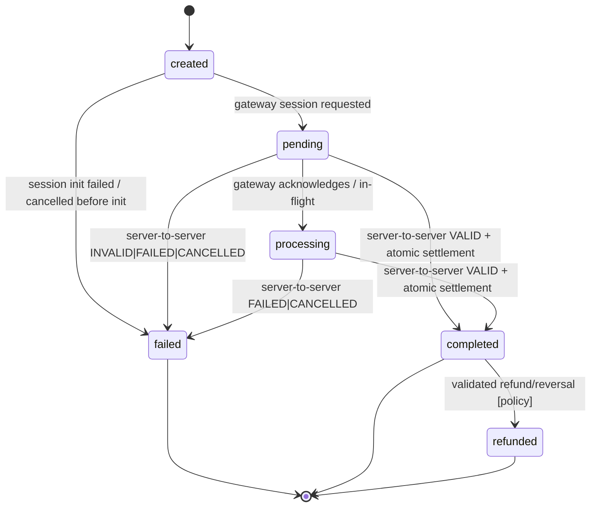

# Storefy Payment Settlement Architecture

**Status:** Proposed design (READ-ONLY architecture deliverable). **Not implemented. Gateway integration is not ready.**  
**Intended first gateway:** SSLCOMMERZ (provider-neutral design).  
**Scope:** Subscription payments (initial/renewal/upgrade/downgrade as applicable), building on existing manual verification.

## Legend

| Label | Meaning |
|---|---|
| **[Existing]** | Verified in current codebase/migrations (037–048 applied). |
| **[Proposed]** | Recommended architecture/change; not present today. |
| **[Requires SSLCOMMERZ docs]** | Gateway-specific detail that must be confirmed from official SSLCOMMERZ documentation/merchant agreement before implementation. |
| **[Human approval]** | Product, security, or business decision requiring explicit sign-off. |

Migrations **037–048 are applied and must not be edited**. Any schema/RPC evolution must be delivered via **new migrations**.

---

## Architecture summary

1. **[Existing]** Storefy has a trusted, server-side subscription payment creation path (`lib/subscriptions/payments.ts`, `/api/subscriptions/payments/upgrade|renewal`) that derives tenant context from auth, computes amounts/periods/proration server-side, and persists payments as `provider='manual'`, `status='verification_required'`, `currency='BDT'` with strong idempotency keys and DB constraints. Upgrades are scheduled and persisted atomically via `public.create_subscription_upgrade_payment` (048, `service_role`-only). Manual settlement is performed by Super Admin through `POST /api/platform/payments/[id]/verify` → `public.approve_or_reject_payment` (047), which enforces authorization, `FOR UPDATE` locking, tenant/amount/currency/period/target validation, atomic subscription side-effects, and immutable audit logging.
2. **[Proposed]** Introduce a provider-neutral gateway layer: (a) payment initiation creates a pending/processing internal payment and a gateway session, (b) customer is redirected to gateway, (c) browser return is treated as UX-only, (d) IPN/callback triggers **server-to-server validation** against SSLCOMMERZ, (e) a **trusted automated settlement path** (service-role/invoker-restricted RPC or equivalent) applies the same invariants as 047 to settle idempotently and update subscriptions/audit, (f) reconciliation handles delays/failures.
3. **[Proposed]** Preserve manual verification end-to-end: existing Super Admin RPC/API/UI remain valid for manual flows; automated path must be additive and invariant-parity, never bypass or weaken 047 checks.
4. **[Existing gap]** No gateway session creation, callback/IPN endpoints, server-to-server validation client, or automated settlement path exists today.

---

## 1. Current architecture (existing, verified)

### 1.1 Data model
- **`public.payments`** (038, extended 046): `tenant_id`, `subscription_id`, `purpose` (`subscription_initial|renewal|upgrade|downgrade|manual_topup|refund`), `provider` (`bkash|sslcommerz|stripe|manual|system`), `amount numeric(12,2)`, `currency` (default `BDT`), `status` (`pending|processing|completed|failed|refunded|verification_required`), `provider_transaction_id`, `idempotency_key` (unique), `metadata jsonb`, `verified_by/verified_at`, `failure_reason`, `verification_notes`, `renewal_period_start/end`, `target_plan_id`, `expected_amount`. Unique `(subscription_id, renewal_period_end)` for renewal with trusted period (046). RLS: super admins manage; tenant admins read own.
- **`public.subscriptions`** (037): per-tenant lifecycle/billing periods, single active-ish subscription (partial unique), `scheduled_plan_id/scheduled_plan_change_at`.
- **`public.payment_verification_audit`** (042): immutable, append-only; super-admin SELECT; no authenticated INSERT (RPC-only by design).

### 1.2 Creation flows
- **APIs:** `POST /api/subscriptions/payments/upgrade` (`app/api/subscriptions/payments/upgrade/route.ts`), `POST /api/subscriptions/payments/renewal` (`app/api/subscriptions/payments/renewal/route.ts`) — Zod validation, service delegation.
- **Service:** `lib/subscriptions/payments.ts`. `authorizeTenant()` uses server auth (`getTenantContext`, tenant admin or super admin); client cannot supply tenant/subscription/amount. Constants: `manual`, `BDT`, `verification_required`.
- **Upgrade:** validates active subscription and higher-priced active target; server proration via `lib/subscriptions/payment-calculation.ts:prorateUpgradeAmount`; deterministic idempotency `sub_upgrade:{subscriptionId}:{targetPlanId}` (retry suffix on prior failed). Atomic persistence via `public.create_subscription_upgrade_payment` (048, `SECURITY DEFINER`, `search_path` set, **`service_role` only**): locks subscription, validates state/plan/price, sets `scheduled_plan_*`, inserts payment with `expected_amount`/trusted metadata. No activation on creation.
- **Renewal:** deterministic period `start=max(current_period_end,now)`, `end=start+1mo` (`computeRenewalPeriod`), idempotency `sub_renewal:{subscriptionId}:{renewalPeriodEndISO}`, direct insert with unique-violation recovery; full monthly amount server-calculated.

### 1.3 Settlement (manual) and audit
- **Super Admin APIs:** list/detail `app/api/platform/payments/*`, decision `POST .../[id]/verify` → `supabase.rpc('approve_or_reject_payment')`, audit read `.../[id]/audit`.
- **RPC 047 `approve_or_reject_payment` (authoritative):** requires `is_super_admin()`, validates decision/status/purpose, `FOR UPDATE` locks (payment, subscription), tenant consistency fail-closed, trusted-field checks (renewal period continuity/bounds; upgrade target/expected amount/amount/currency/scheduled plan/active target), atomic status transition `verification_required → completed|failed`, subscription side-effects (initial/renewal activate with trusted periods; upgrade applies `plan_id` immediately, clears schedule, preserves billing dates; downgrade intent confirmed; matching-upgrade rejection clears stale schedule), immutable audit insert, idempotent on terminal/repeat and concurrent cases. Granted to `authenticated, service_role`.
- **Audit:** `payment_verification_audit` records admin decision and previous/new status.

### 1.4 Known gaps
- **[Existing gap]** No gateway session/init, no callback/IPN routes (only `app/auth/callback/route.ts`), no server-to-server validation, no automated settlement path, no provider abstraction module. `048`/service hardcode `manual`+`verification_required`.

---

## 2. Target end-to-end flow (proposed)

`Payment Initiation → Gateway Session Creation → Customer Redirect → Gateway Callback/IPN (untrusted signal) → Server-to-Server Validation → Transaction & Amount Verification → Atomic Automated Settlement → Subscription State Update → Audit Logging`

- **Browser redirect/success page:** UX and status polling only; **never proof of payment**.
- **Settlement trigger:** only after successful server-to-server validation correlated to an internal payment.
- **Manual path:** remains available and unchanged in invariants.

---

## 3. Gateway session creation

### 3.1 Placement
- **[Proposed]** Keep initiation behind authenticated tenant APIs: evolve `app/api/subscriptions/payments/upgrade|renewal/route.ts` to call a provider-aware application service (extend `lib/subscriptions/payments.ts` or a sibling orchestrator) that: (1) authorizes tenant server-side, (2) computes trusted amount/period/proration/target (unchanged), (3) creates or reuses an internal payment record atomically, (4) requests a gateway session via a **server-only** gateway client, (5) stores gateway session refs, (6) returns redirect/session data to the client.
- **[Proposed]** Do not allow the browser to choose amount, currency, tenant, subscription, plan, or period.

### 3.2 Internal payment ↔ gateway correlation
- **[Proposed]** Treat internal `payments.id` (UUID) as the canonical merchant-side correlation key. Pass it as the gateway order/tran identifier only in forms allowed by SSLCOMMERZ; also persist any gateway-issued session/transaction identifiers in `provider_transaction_id` and structured `metadata` (e.g. `gateway_session_id`, `gateway_tran_id`, `provider`, timestamps).
- **[Requires SSLCOMMERZ docs]** Confirm supported/required fields for merchant transaction ID, session ID, value fields, and which identifier is authoritative in validation responses and IPN payloads; confirm allowed charset/length/uniqueness rules.
- **[Proposed]** Settlement must resolve the internal payment by a trusted stored mapping (internal id and/or previously stored gateway ids), never by tenant/user-supplied identifiers from callback payloads alone.

### 3.3 Preventing duplicate payment sessions
- **[Existing]** Reuse deterministic idempotency: upgrade `sub_upgrade:{subscriptionId}:{targetPlanId}` (+ retry suffix on failed) and renewal `sub_renewal:{subscriptionId}:{renewalPeriodEndISO}`; DB unique constraints and RPC conflict handling.
- **[Proposed]** For an existing non-terminal, non-failed online payment with a valid unexpired session, return/reuse the session instead of creating a new gateway order (subject to gateway session lifetime). For expired sessions, require an explicit re-init path that preserves idempotency (e.g. rotate gateway session ref while keeping one logical internal payment, or create a new attempt only when prior is definitively failed/expired per policy).
- **[Requires SSLCOMMERZ docs]** Session expiry semantics and whether a tran_id may be re-initiated.
- **[Human approval]** Policy for “retry after pending/timeout” vs “new payment attempt”.

### 3.4 Gateway session creation failures
- **[Proposed]** Wrap “DB create/reserve + gateway init” with compensating handling: if gateway init fails after reserving a record, mark payment to a non-settleable failure state (e.g. `failed` with `failure_reason='gateway_session_init_failed'`) or roll back the reservation if not yet externally visible—chosen to avoid orphaned payable records while keeping auditability. Never leave an ambiguous record that could later be auto-settled without validation.
- **[Proposed]** Return sanitized errors to client; log structured diagnostic context server-side (redacted). Make client retries safe via idempotency keys.

### 3.5 Secure storage of gateway references
- **[Proposed]** Store non-secret references/ids/status markers in `provider_transaction_id` and `metadata` (jsonb). Never store store passwords, API secrets, or raw signature secrets in DB or logs.
- **[Requires SSLCOMMERZ docs]** Identify which returned fields are sensitive and must be redacted/minimized.
- **[Proposed]** If any value must be persisted for validation correlation, store minimal necessary data and redact in admin/tenant projections where not required.

---

## 4. Callback and IPN processing

### 4.1 Why browser redirects cannot be trusted
- **[Proposed, security-critical]** Redirect/success/fail/cancel URLs are user-agent controlled: parameters can be forged, replayed, dropped, or never delivered; the browser may close before return. They provide **no proof** of funds movement or final gateway state. Therefore redirects may only update UX state (e.g. “processing, awaiting confirmation”) and must never trigger settlement or subscription activation.

### 4.2 Proposed endpoints and responsibilities
- **[Proposed]** Add server-only handlers (e.g. `app/api/payments/sslcommerz/success|fail|cancel/route.ts` for browser returns, `app/api/payments/sslcommerz/ipn/route.ts` for server-to-server notification). All accept unauthenticated gateway traffic; use `createServiceClient`/service-role DB access.
- **[Proposed]** Return/cancel handlers: validate request shape minimally, correlate to internal payment if safely possible, render/redirect user to a status page; do **not** settle. IPN (or the designated server notification) enqueues/performs validation+settlement.

### 4.3 Authentication and validation of callbacks
- **[Proposed]** Treat every callback/IPN as untrusted input: enforce strict parsing, method/content-type checks, size limits, and source-agnostic processing (do not rely on IP allowlists alone). Correlate to a known internal payment, then perform **server-to-server validation** with SSLCOMMERZ using stored merchant credentials and the gateway’s authoritative validation mechanism before any state change.
- **[Requires SSLCOMMERZ docs]** Official validation API/endpoint, required parameters, response fields, signature/hash or verify-sign mechanism (if provided), canonical status values, and whether validation must echo/store-specific identifiers.
- **[Proposed]** Reject if validation cannot be completed or authenticity cannot be established (fail closed; keep payment in a reconcilable pending/processing state, not completed).

### 4.4 Repeated and out-of-order callbacks
- **[Proposed]** Design handlers to be **idempotent and order-tolerant**: load/lock the internal payment, re-fetch/confirm authoritative gateway state via server-to-server validation, then apply a conditional transition only if still allowed. Ignore duplicates that resolve to an already-settled terminal outcome for the same validated transaction. If a “fail/cancel” arrives after a validated “success” (or vice versa), the **validated authoritative state** and current DB terminal state win—do not downgrade a completed, validated payment.
- **[Requires SSLCOMMERZ docs]** Definitive status taxonomy, possible reversals/chargebacks, and IPN retry behavior/ordering guarantees (if any).
- **[Human approval]** Business rule for late failure after provisional success signal (if gateway semantics allow).

### 4.5 Idempotent processing
- **[Proposed]** Enforce idempotency at (1) application: early no-op on terminal states, (2) DB: conditional updates/unique constraints on provider transaction correlation, (3) settlement RPC: reuse 047-style idempotent returns and row locks so concurrent/duplicate IPNs cannot double-apply subscription effects.

---

## 5. Server-to-server validation (required checks)

All checks run server-side against **stored trusted internal payment data** and **gateway validation response** before settlement. **Fail closed** on any mismatch or uncertainty.

| # | Check | Purpose | Notes |
|---|---|---|---|
| 1 | **Authenticity / validation call success** | Confirm gateway reports a genuine transaction via its official validation mechanism | **[Requires SSLCOMMERZ docs]** exact API, params, and integrity/signature fields if any. |
| 2 | **Merchant/store identity** | Ensure response belongs to Storefy’s merchant/store | **[Requires SSLCOMMERZ docs]** response fields (store/merchant id). Compare to configured expected value (secret/config). |
| 3 | **Gateway transaction/session ID** | Match validated transaction to stored `provider_transaction_id`/session refs | **[Requires SSLCOMMERZ docs]** authoritative field names (`tran_id`, `val_id`, etc.). |
| 4 | **Internal payment correlation** | Resolve exactly one internal `payments` row (by stored tran/session/internal id mapping) and confirm `tenant_id/subscription_id/purpose` integrity | Never trust callback-supplied tenant. |
| 5 | **Amount** | Validated amount equals trusted internal amount (and for upgrades equals/consistent with `expected_amount` rules) | **[Proposed]** compare in smallest/canonical units or fixed decimal with strict equality; define rounding policy. **[Requires SSLCOMMERZ docs]** amount formatting/currency decimal rules. |
| 6 | **Currency** | Validated currency equals `payments.currency` (`BDT` today) | Reject mismatch. |
| 7 | **Payment status** | Map gateway-validated status to internal outcome (success/failed/cancelled/pending) | **[Requires SSLCOMMERZ docs]** definitive status values and risk/validation flags. |
| 8 | **Duplicate/consistency detection** | Same gateway transaction must not settle a different internal payment or settle twice; detect conflicting amounts/states | **[Proposed]** enforce via stored refs + unique/conditional guards. |
| 9 | **Context eligibility** | Payment in settleable state for the transition; subscription/payment linkage valid (reuse 047 invariants) | **[Existing]** tenant match, period/target/expected checks on approval paths. |

**[Proposed]** Log each failed check (redacted) with a reason code for reconciliation/alerting.

---

## 6. Automated settlement

### 6.1 Constraint and design principle
- **[Existing]** `approve_or_reject_payment` (047) requires `is_super_admin()` and is the only current trusted settlement implementation; it encodes critical invariants (authorization, locks, validation, atomic subscription updates, audit).
- **[Proposed]** Gateway callbacks **cannot** impersonate a Super Admin. Introduce a **separate trusted server-side settlement path** callable only from privileged server context (service role / internal invoker), **not** from browser/client-authenticated tenants, that reuses the same business invariants and side-effects as 047.

### 6.2 Recommended mechanism (parity without weakening manual path)
- **[Proposed]** Extract/refactor settlement core in a **new migration** (do not edit 037–048) into shared logic, e.g. an internal function that: given a locked, validated payment and decision/outcome, performs amount/currency/period/target/subscription checks, applies the same state transitions and subscription mutations, and writes audit. Expose two controlled entrypoints:
  - **Manual:** `approve_or_reject_payment` remains Super-Admin-authorized (`is_super_admin()`), preserving current API/behavior.
  - **Automated:** e.g. `settle_payment_gateway(p_payment_id, p_outcome, p_provider_txn_id, p_validation_ref/metadata, p_reason)` **SECURITY DEFINER**, `search_path` pinned, **revoked from PUBLIC/anon/authenticated, granted to `service_role` only**, enforcing “validated gateway settlement” preconditions and recording a non-human/system actor in audit (see 6.4).
- **[Proposed alternative]** If refactor risk is high, implement a parallel `service_role`-only RPC that duplicates 047’s invariant matrix exactly for gateway outcomes and is covered by parity tests; **[Human approval]** required due to drift risk. (Extraction is preferred.)
- **[Proposed]** Application must call automated settlement only **after** successful server-to-server validation (§5) and within a path that ensures single-writer semantics per payment.

### 6.3 Invariants to preserve (must match 047 semantics)
- **Atomicity:** payment status change, subscription mutation, and audit insert in one transaction.
- **Row locking:** `FOR UPDATE` on payment and subscription during decision.
- **Tenant consistency:** `payment.tenant_id == subscription.tenant_id` fail-closed.
- **Validation:** purpose/status eligibility; renewal trusted `renewal_period_*` present, ordered, and continuity/eligibility checks; upgrade `target_plan_id`, `expected_amount`, scheduled plan match, active target, currency/amount match to trusted expected amount; subscription state eligibility per purpose.
- **Idempotency:** repeat/terminal and concurrent processing return safe, non-duplicating outcomes.
- **Correct effects:** initial/renewal activate with trusted periods; upgrade applies target plan immediately, clears schedule, preserves billing anchor/dates/usage; downgrade confirms intent; rejection of matching upgrade clears stale scheduled plan.

### 6.4 Audit history
- **[Existing]** `payment_verification_audit` requires `admin_user_id` and stores decision/previous/new status/reason.
- **[Proposed]** Represent automated settlements distinctly (e.g. allow/system actor convention, extended columns, or metadata linkage) so auditors can differentiate gateway-validated actions from Super Admin decisions. **[Human approval]** schema/semantic choice (and any RLS/reporting impact) delivered via new migration; must not weaken immutability guarantees.

### 6.5 Alignment with payment creation
- **[Proposed]** Online flows will require provider-aware, status-appropriate creation (e.g. `pending`/`processing`, `provider='sslcommerz'`, stored gateway refs) while keeping server-trusted pricing/period/proration/idempotency and atomic upgrade scheduling. Because `048` hardcodes `manual`/`verification_required` and is `service_role`-only, introduce a **new** atomic creation RPC/path for gateway-initiated payments with equivalent validation guarantees.

---

## 7. Failure and recovery

| Scenario | Expected handling | Recovery |
|---|---|---|
| **Gateway session creation failure** | No redirect to a payable session; reserve not left settleable/ambiguous; mark failed or compensate per policy | Client retry with idempotency; ops alert on elevated rate |
| **Customer cancellation** | Redirect shows cancelled; IPN/validation (if any) treated as non-success; payment becomes `failed`/cancelled-equivalent only via validated outcome or controlled expiry | Allow new attempt per idempotency/retry policy |
| **Failed payment** | Validated failure → idempotent transition to `failed`, record reason, clear matching upgrade schedule where applicable | User may retry (new attempt per key policy) |
| **Pending/processing** | Remain non-terminal; no subscription effect | Polling/reconciliation and timeout policy |
| **Delayed IPN** | Process when received; server-to-server validation determines truth; settlement idempotent even if long after creation (renewal uses payment-bound period, already aligned) | None if idempotent; audit timestamped |
| **Duplicate IPN** | No-op/identical result after first validated settlement | Safe by design (locks, terminal checks, unique refs) |
| **Amount mismatch** | **Reject settlement**, fail closed; mark for investigation (do not complete) | Manual reconciliation; possible refund per gateway outcome **[Human approval]** |
| **Transaction mismatch / unknown tran** | Do not mutate internal state; log and alert | Investigation; ignore or quarantine |
| **Gateway timeout / validation unavailable** | Do not guess; keep pending/reconcilable, schedule retry with backoff | Reconciliation job/manual verify once authoritative state known |
| **Storefy outage during/after IPN** | Gateway may retry IPN; on recovery, idempotent handler revalidates and settles once | At-least-once processing assumption; durable idempotency required |
| **Payment captured at gateway but settlement failed locally** | Critical: detect via validation showing success while DB not completed | **Reconciliation queue/runbook** to retry settlement; alert; prevent double-credit; escalate to manual resolution if invariant violation |
| **Refund/reversal notifications** | **[Requires SSLCOMMERZ docs]** availability and semantics | **[Proposed]** record event, update payment/subscription per approved business rules, full audit; **[Human approval]** entitlement/period handling on reversal |

**[Proposed]** Reconciliation: periodic job (and on-demand admin action) to query non-terminal aged payments, revalidate with gateway, and converge state; dashboard/alerts for “validated success but not settled”, “mismatch”, and “stale pending”.

---

## 8. Security and observability

### 8.1 Secret management
- **[Proposed]** Store SSLCOMMERZ credentials (store id/password/API keys/secrets) in server-only environment/secret manager; never expose to client bundles, tenant APIs, or logs. Rotate per policy. **[Human approval]** ownership and rotation runbook.

### 8.2 Authenticity, replay, and abuse protection
- **[Proposed]** Rely on server-to-server validation as source of truth; verify any gateway-provided integrity/signature fields per docs (**[Requires SSLCOMMERZ docs]**). Bind validation to stored internal payment and expected merchant/amount/currency. Mitigate replay via idempotent terminal-state handling and unique transaction correlation. Apply rate limiting/WAF rules on callback endpoints and strict payload limits to reduce abuse.

### 8.3 Logging and redaction
- **[Proposed]** Structured, server-side logs with correlation ids (internal payment id, provider, hashed/redacted gateway refs). **Never log** secrets, full credentials, or unnecessary PII/financial payloads; redact sensitive fields from gateway responses before persistence/logging. Ensure admin/tenant APIs do not leak raw gateway secrets.

### 8.4 Monitoring and alerting
- **[Proposed]** Metrics/alerts for: validation failures, amount/currency/merchant mismatches, unknown transactions, repeated IPNs, settlement errors, “success-not-settled” backlog, gateway latency/timeouts, and callback endpoint error spikes.

### 8.5 Audit requirements
- **[Existing]** Immutable `payment_verification_audit` for manual decisions.
- **[Proposed]** Record every automated settlement attempt outcome (success/failure reason codes, correlation refs, actor=system/gateway path) with immutability guarantees equivalent to current audit; retain evidence needed for dispute/reconciliation consistent with policy. **[Human approval]** retention/compliance requirements.

---

## 9. Implementation blueprint

### A. Proposed payment lifecycle state machine

- **[Existing]** Allowed statuses today include `pending, processing, completed, failed, refunded, verification_required`.
- **[Proposed]** Manual flow continues to use `verification_required` → `completed|failed` via 047. Online flow uses `pending/processing` → `completed|failed` via automated settlement (exact mapping **[Requires SSLCOMMERZ docs]**). Any intermediate “initiated/session_created” may be represented in `status` and/or `metadata` (**[Human approval]**).

### B. Proposed database changes (no migrations written)

- **[Proposed, new migration(s)]**: automated settlement RPC (and optionally shared internal core) with `service_role`-only execute; preserve/encode 047 invariants and audit semantics for system-actor settlements.
- **[Proposed, new migration(s)]**: gateway-aware atomic creation RPC/path (parameterized provider/status/gateway refs) equivalent in safety to 048 for upgrades and a guarded path for renewals/initial as needed.
- **[Proposed]**: constraints/indexes to support correlation and dedupe, e.g. uniqueness/lookup on provider transaction identifiers per provider where appropriate (nullable-safe), and any metadata conventions—designed to avoid breaking existing rows.
- **[Proposed]**: audit representation for automated actor/outcome details if `payment_verification_audit` shape is insufficient (**[Human approval]**).
- **[Existing]**: keep all 037–048 objects/behaviors intact; extend, do not rewrite history.

### C. Proposed API routes

| Route | Method | Purpose | Trust |
|---|---|---|---|
| `/api/subscriptions/payments/upgrade` | POST | **[Existing → evolve]** initiate upgrade; return gateway redirect/session when provider is online | Tenant-authenticated |
| `/api/subscriptions/payments/renewal` | POST | **[Existing → evolve]** initiate renewal; return gateway redirect/session | Tenant-authenticated |
| `/api/payments/sslcommerz/ipn` | POST | **[Proposed]** server notification: validate S2S → settle idempotently | Gateway (untrusted) + server validation |
| `/api/payments/sslcommerz/success` | GET/POST | **[Proposed]** browser return UX only | Untrusted; no settlement |
| `/api/payments/sslcommerz/fail` | GET/POST | **[Proposed]** browser return UX only | Untrusted; no settlement |
| `/api/payments/sslcommerz/cancel` | GET/POST | **[Proposed]** browser return UX only | Untrusted; no settlement |
| `/api/payments/[id]/status` (or equivalent) | GET | **[Proposed]** tenant-visible polling of internal status post-redirect | Tenant-authenticated/authorized |
| `/api/platform/payments/[id]/verify` | POST | **[Existing]** manual Super Admin decision (unchanged contract/invariants) | Super Admin |

**[Requires SSLCOMMERZ docs]** required callback/IPN URL patterns, HTTP methods, and payload formats.

### D. Proposed server-only gateway service structure

- **[Proposed]** `lib/payments/gateway/types.ts`: provider-neutral interfaces (`createSession`, `validateTransaction`, normalized outcome model).
- **[Proposed]** `lib/payments/gateway/sslcommerz/client.ts` (and config): init + validation calls, request signing/param construction per docs (**[Requires SSLCOMMERZ docs]**), timeout/retry-safe behavior.
- **[Proposed]** `lib/payments/gateway/sslcommerz/verify.ts`: response parsing, authenticity/field checks, normalization.
- **[Proposed]** `lib/payments/settlement/`: orchestration that (1) loads internal payment, (2) runs S2S validation, (3) enforces correlation/amount/currency checks, (4) invokes automated settlement RPC, (5) records observability events. Server-only; no client imports.

### E. Proposed settlement RPC/service design

- **[Proposed]** `public.settle_payment_gateway(...)` (name illustrative) in new migration: inputs include payment id, validated outcome, provider transaction identifiers, and minimal validation evidence refs; performs `FOR UPDATE` locking, revalidates settleability and all 047-relevant invariants against stored trusted fields, conditionally transitions status, applies identical subscription effects, inserts immutable audit row with system/gateway attribution, returns structured idempotent result. **`service_role` execute only**.
- **[Proposed]** Keep `approve_or_reject_payment` for Super Admin manual decisions; optionally refactor to share internal logic without changing external behavior/permissions. **[Human approval]** any change to manual API semantics.

### F. Required tenant-facing payment UI changes

- **[Proposed]** Upgrade/renewal flows must handle an initiation response containing redirect/session data, navigate user to gateway, and provide a return/pending page that polls internal payment status until terminal (no trust in redirect params).
- **[Proposed]** Clear states for pending, success-confirmed, failed, cancelled, and “awaiting confirmation” (delayed IPN); retry affordances consistent with idempotency policy.
- **[Proposed]** Surface provider/reference info only if safe and useful; never expose secrets.

### G. Required Super Admin UI changes

- **[Proposed]** Display provider, gateway transaction refs (redacted as needed), online vs manual origin, validation/settlement timestamps, failure reasons, and reconciliation flags.
- **[Proposed]** Preserve manual approve/reject for `verification_required` payments; define and display whether/when manual override is allowed for gateway-initiated payments (**[Human approval]**).
- **[Proposed]** Views/filters for “pending validation”, “success at gateway but unsettled”, and mismatches to support operations.

### H. Testing strategy

- **[Proposed]** Unit: amount/currency/period/proration invariants; idempotency key generation; gateway response normalization and mismatch detection (with fixtures derived from official docs once available).
- **[Proposed]** Integration/DB: settlement RPC parity with 047 cases (renewal continuity/overdue bounds, upgrade target/expected/schedule, tenant mismatch, idempotent repeats, concurrent locks) for both manual and automated entrypoints.
- **[Proposed]** Callback/IPN: duplicate delivery, out-of-order events, replayed payloads, delayed IPN, validation-unavailable retries, unknown/mismatched tran_id, amount/currency/merchant tampering (must not settle).
- **[Proposed]** End-to-end (sandbox): success/fail/cancel, browser-return without IPN, IPN without browser return, session-init failure, and recovery from “validated success but local settlement failure”.
- **[Proposed]** Security: ensure no secret leakage in logs/responses; rate-limit behavior; authz boundaries (`service_role`-only settlement, super-admin-only manual verify).

### I. Ordered implementation phases with dependencies

1. **Prerequisites & decisions** — obtain SSLCOMMERZ docs/credentials (sandbox), confirm fields/validation/status semantics, and secure **[Human approval]** items (state mapping, retry/expiry, manual override, refund/reversal policy, audit actor model). *Dependency: none.*
2. **Design finalization** — lock state machine mapping, correlation strategy, and parity plan for settlement/creation RPCs. *Depends on 1.*
3. **Database (new migrations)** — shared/automated settlement RPC + audit support + gateway-aware atomic creation + correlation constraints. *Depends on 2.*
4. **Server gateway & validation module** — SSLCOMMERZ client, S2S validation, normalization, redaction-safe logging. *Depends on 1–2.*
5. **Callback/IPN and settlement orchestration** — routes/handlers, idempotent validate→settle flow, reconciliation hooks. *Depends on 3–4.*
6. **Tenant initiation & UI** — provider-aware create APIs and redirect/polling UX. *Depends on 3–4.*
7. **Super Admin & ops** — visibility, reconciliation tooling/alerts, runbooks. *Depends on 5.*
8. **Sandbox verification & hardening** — full test matrix, failure-injection, observability tuning. *Depends on 5–7.*
9. **Production readiness review** — security review, secret/rotation setup, monitoring, go-live checklist. *Depends on 8 and credentials/approvals.*

---

## 10. Critical security decisions

1. **Redirects are never proof of payment**; settlement only after server-to-server validation. **[Proposed]**
2. **Gateway callbacks cannot impersonate Super Admin**; automated settlement must use a separate `service_role`-only trusted path with invariant parity to 047, while keeping manual verification intact. **[Proposed, Human approval]**
3. **Fail-closed validation:** any authenticity/correlation/amount/currency/status/merchant uncertainty blocks settlement and routes to reconciliation. **[Proposed]**
4. **Idempotency and concurrency are mandatory:** deterministic keys, DB constraints, conditional transitions, and row locks prevent double-settlement/subscription double-application. **[Existing + Proposed]**
5. **Secrets and sensitive payloads are server-only and redacted** from logs, storage, and UI. **[Proposed]**
6. **Do not invent gateway fields or behavior**; implementation gated on official SSLCOMMERZ documentation. **[Requires SSLCOMMERZ docs]**

---

## 11. Missing external prerequisites

- SSLCOMMERZ merchant account, sandbox and production credentials, and store configuration. **[Requires SSLCOMMERZ docs]**
- Official documentation for: session/init API, redirect and IPN/callback contracts, server-to-server validation API, status codes, amount/currency formats, transaction/session/validation identifiers, integrity/signature mechanism (if any), timeout/retry behavior, and refund/reversal notifications. **[Requires SSLCOMMERZ docs]**
- Registered callback/IPN/return URLs reachable from gateway (environment/network configuration). **[Proposed]**
- Approved runbooks/policies for reconciliation, manual overrides, refunds, and incident response. **[Human approval]**

---

## 12. Recommended implementation sequence

1. Confirm SSLCOMMERZ contract/credentials and resolve human-approval decisions.
2. Implement invariant-parity DB primitives (automated settlement + gateway-aware creation) as new migrations.
3. Build server-only gateway client and strict S2S validation/normalization.
4. Implement idempotent IPN/callback handling with validate→settle orchestration and reconciliation hooks.
5. Update initiation APIs/services and tenant redirect/polling UI.
6. Extend Super Admin/ops visibility and alerts.
7. Execute sandbox test matrix (duplicates, delays, tampering, recovery) before any production enablement.

---

## 13. Unresolved architectural questions (require human approval / external confirmation)

1. **Automated audit actor model:** represent system/gateway settlements in `payment_verification_audit` via schema extension, reserved actor, or companion record while preserving immutability? **[Human approval]**
2. **Settlement RPC strategy:** refactor shared core vs parity-duplicated RPC for automated path (drift vs migration risk). **[Human approval]**
3. **Online payment state mapping:** exact use of `pending`/`processing`/metadata and whether `verification_required` remains manual-only. **[Human approval]**
4. **Retry/session policy:** reuse vs rotate gateway sessions on expiry; when a pending attempt may be superseded. **[Requires SSLCOMMERZ docs, Human approval]**
5. **Manual override policy:** can Super Admin manually settle/fail a gateway-initiated payment, and under what evidence? **[Human approval]**
6. **Refunds/reversals/chargebacks:** supported gateway events and required subscription/entitlement effects. **[Requires SSLCOMMERZ docs, Human approval]**
7. **Reconciliation SLA and ownership:** frequency, alert thresholds, and on-call/runbook responsibilities. **[Human approval]**
8. **Initial subscription purchases:** current inspected flows focus on upgrade/renewal; confirm whether `subscription_initial` will be gateway-settleable in the same phase. **[Human approval]**

---

**End of report. This document is a design proposal only; no implementation or gateway enablement has been performed.**
